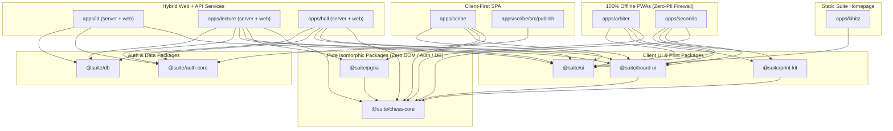

# Kibitz Chess Suite — Architecture & Privacy Boundaries

This document defines the workspace dependency graph, privacy invariants, ESLint guardrails, and conventions governing the Kibitz Chess Suite monorepo (`AGPL-3.0-only`).

---

## 1. Non-Negotiable Privacy & Security Invariants

1. **Zero-Upload Offline Firewall (`apps/arbiter`, `apps/seconds`):**
   - Offline-first PWAs (`vite-plugin-pwa`, `registerType: "autoUpdate"`).
   - **MUST NEVER** import `@suite/auth-core`, `@suite/db`, or any analytics/telemetry library.
   - **MUST NEVER** upload or transmit club rosters, student names, or scoresheets to any server.
   - May perform optional **read-only `GET` pulls** (for example, pulling scheduled tournament data) using the browser's shared cross-subdomain KibitzID session cookie via `@suite/ui`'s `pullReadOnlyFromService`.
2. **Invite-Only Identity (`apps/id`):**
   - Public open registration does not exist. All accounts are created via single-use or quota-limited invite codes.
   - The `users` schema avoids PII (pseudonymous case-insensitive unique handles only; no real names or student emails).
3. **Double-Blind Coach-Student Linking (`apps/id`, `@suite/auth-core`):**
   - Students may link to multiple coaches simultaneously.
   - `POST /links/intent` accepts a handle and **always** returns an identical HTTP `202` generic body regardless of whether the target handle exists or whether a mutual link activated. Zero notifications are emitted.
   - Effective student library access is the union of all active (non-revoked) coach links, school/program memberships, and public moderated studies.
4. **Student Interaction Restrictions (`apps/lecture`, `apps/hall`, `@suite/ui`):**
   - Student accounts have no free-text chat, no DMs, and no public profiles.
   - Student feedback is restricted to `<EmojiReactionBar />` (backed by the fixed `student_emoji` PostgreSQL enum).
5. **No General Play on `apps/hall`:**
   - Exclusively for scheduled club tournaments paired via `arbiter` or club organizers. No open lobby, no random matchmaking, no chat.

---

## 2. Workspace Dependency Graph

---

## 3. Enforced ESLint & Static Boundaries

Boundaries are enforced in `eslint.config.mjs` and verified automatically in CI via `pnpm verify:boundaries` (`scripts/verify-boundaries.mjs`):

| Workspace / Path                                  | Forbidden Imports / Globals                                                                                                                                                                                  |
| :------------------------------------------------ | :----------------------------------------------------------------------------------------------------------------------------------------------------------------------------------------------------------- |
| `apps/kibitz/**`                                  | `@suite/auth-core`, `@suite/db`, analytics/telemetry packages, sibling apps                                                                                                                                  |
| `apps/arbiter/**`, `apps/seconds/**`              | `@suite/auth-core`, `@suite/db`, analytics/telemetry packages, sibling apps                                                                                                                                  |
| `apps/scribe/src/**` (excluding `src/publish/**`) | `@suite/auth-core`, `@suite/db`, sibling apps                                                                                                                                                                |
| `apps/scribe/src/publish/**`                      | `@suite/db`, sibling apps (`@suite/auth-core` is explicitly permitted here)                                                                                                                                  |
| `apps/*/src/web/**`                               | `@suite/db`, sibling apps                                                                                                                                                                                    |
| `apps/*/src/server/**`                            | Sibling apps                                                                                                                                                                                                 |
| `packages/chess-core/**`, `packages/pgna/**`      | `react`, `react-dom`, `@suite/db`, `@suite/auth-core`, `@suite/ui`, `@suite/board-ui`, and browser DOM globals (`window`, `document`, `navigator`, `localStorage`, `sessionStorage`, `HTMLElement`, `Audio`) |

---

## 4. Hybrid App Convention (`id`, `lecture`, `hall`)

Each hybrid app lives in a single workspace package under `apps/<name>/`:

- `src/server/` — Node.js 22 + Hono (+ `ws` in `hall`), checked by `tsconfig.server.json` (`@suite/tsconfig/node-service.json`), compiled to `dist-server/`.
- `src/web/` — Vite + React 19 + Tailwind CSS v4, checked by `tsconfig.web.json` (`@suite/tsconfig/react-app.json`), compiled to `dist-web/`.
- `index.html` at the app root points to `/src/web/main.tsx`.

---

## 5. Subdomain & Local Port Map

| Workspace      | Production Subdomain | Vite Dev Port | Backend API / WS Port | Auth Required?            |
| :------------- | :------------------- | :-----------: | :-------------------: | :------------------------ |
| `apps/kibitz`  | `<domain>`           |    `5170`     |           —           | Optional (top-menu sign-in) |
| `apps/id`      | `id.<domain>`        |    `5171`     |        `4001`         | Core Auth Service           |
| `apps/lecture` | `lecture.<domain>`   |    `5172`     |        `4002`         | Optional (primers public)   |
| `apps/hall`    | `hall.<domain>`      |    `5173`     |        `4003`         | Yes / Seat Token            |
| `apps/scribe`  | `scribe.<domain>`    |    `5174`     |           —           | Optional (publish only)     |
| `apps/arbiter` | `arbiter.<domain>`   |    `5175`     |           —           | Optional read-only pull     |
| `apps/seconds` | `seconds.<domain>`   |    `5176`     |           —           | Optional read-only pull     |
